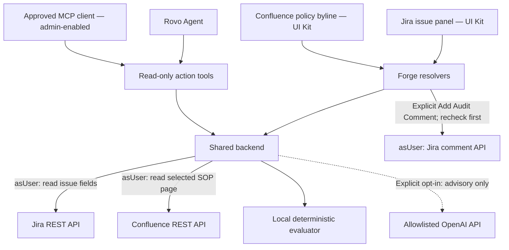

# Policy Compliance Copilot

Increment 1: Jira issue panel, Confluence SOP byline, Rovo agent, two read-only action/MCP tools. JavaScript + UI Kit; no persistent app storage. No automatic events, no payment approvals.

## Codegeist 2026 — reviewer guide

**Business problem:** Finance and Procurement teams need to catch missing vendor quotations, unsupported amounts, prohibited spending categories, and missing approval references before a request advances.

**Demo scope:** user-triggered checks against a selected Confluence SOP. No autonomous payment approval, background monitoring, policy search, or verified attachment analysis. Use synthetic issues and SOPs only.

### Architecture



| Component | Responsibility |
| --- | --- |
| `manifest.yml` | Jira/Confluence UI modules, Rovo Agent, action/MCP tools, scopes and external egress |
| `src/frontend/index.jsx` | Policy page ID input, rule loading, check results, explicit audit-comment button |
| `src/resolvers/index.js` | UI-to-backend resolver wiring |
| `src/backend.js` | User-authorized REST reads, shared tool handlers, optional AI, audit-comment writes |
| `src/compliance.cjs` | JSON policy parsing, issue-fact extraction, deterministic findings |
| `test/` | Rule regression checks and stubbed backend-boundary checks |

**Data lifecycle:** source data is fetched on demand and evaluated in memory; no app-managed database, persistent cache, or source-content index. Explicit audit comments persist in Jira. Atlassian/Rovo, optional AI providers and MCP clients may retain data independently. See [PRIVACY.md](PRIVACY.md) for the full boundaries.

**Authorization:** every product REST operation uses `api.asUser()`. Jira is the required app; Confluence must be connected on the same site. Read-only Rovo/MCP tools do not create comments. `write:jira-work` is used by the explicit UI comment operation.

### Suggested judging walkthrough

1. Put the example JSON below in a single code block on a synthetic Confluence SOP page. Open its **Policy Compliance** byline and load the rules.
2. Create a Jira issue using the example Description below. Open **Policy Compliance Copilot**, enter the SOP page ID, then choose **Run Compliance Check**.
3. With `Amount: 12000`, `Currency: USD`, `Quote count: 3`, category `software`, vendor and approval reference present, expect `COMPLIANT` for the supported JSON rules.
4. Change `Quote count` to `2`; run again. Expect `NON_COMPLIANT`. Remove the amount instead; expect `NEEDS_REVIEW`.
5. Choose **Add Audit Comment** to persist a freshly recomputed audit. Inspect the SOP version and timestamp in the comment.
6. In Rovo, provide an issue key and SOP page ID. Invoke the same read-only tools. Demonstrate an external MCP client only after authorized installation and admin enablement.

These are expected scenarios from local rules, not claims of a recorded cloud demonstration or competition eligibility. Cloud integration remains unverified.

## SOP format

Use the Confluence page byline **Policy Compliance** to load the current page's rules. In Jira enter that page's numeric ID. Every request re-reads the page as the invoking user and records its version. The app must be connected to Confluence on the same site (Jira is the required product).

For reliable local evaluation, Finance must put this reviewed JSON in one code block on the SOP page:

```json
{
  "quoteThresholds": { "USD": 10000, "IDR": 10000000 },
  "minimumQuotes": 3,
  "approvalThresholds": { "USD": 5000, "IDR": 5000000 },
  "prohibitedCategories": ["gambling", "personal entertainment"]
}
```

Thresholds above are EXAMPLES, not an official policy. Use your organization's actual values. `>` means strictly greater than, currencies are independent; no currency conversion. Free-form-only SOP returns `NEEDS_REVIEW`, not invented compliance. Local evaluation covers this JSON subset only; additional prose/conditions require human review. Keep one JSON object per page.

## Issue format

Use explicit lines in Jira Description (or Summary). Ungrouped decimal amounts avoid locale ambiguity:

```text
Amount: 12000
Currency: USD
Quote count: 3
Category: software
Vendor: Example Vendor
Approval reference: FIN-42
```

Optional operator-controlled environment variables map fields instead:
`JIRA_AMOUNT_FIELD`, `JIRA_CURRENCY_FIELD`, `JIRA_QUOTES_FIELD`,
`JIRA_CATEGORY_FIELD`, `JIRA_VENDOR_FIELD`, `JIRA_APPROVAL_FIELD`.
Values must be Jira IDs such as `customfield_10001`. Numeric fields must return numbers; other mapped fields must return strings. Missing/malformed mapped values do not fall back to prose.

`COMPLIANT` means supplied declarations satisfy supported rules. It does NOT verify vendor quote attachments, authenticity, approval workflow or spending authority. Unknown facts return `NEEDS_REVIEW`; known violations return `NON_COMPLIANT`. Score is percentage of evaluated checks marked PASS, not a financial-risk probability.

**Add Audit Comment** rechecks current Jira/Confluence content before posting under the caller's permissions. Clicking again can create another comment; there is no automatic retry or deduplication.

## Optional external AI

Disabled by default. To opt in, the operator sets Forge runtime variables through CLI (never place credentials in source/chat):

- `EXTERNAL_AI_ENABLED=true`
- `EXTERNAL_AI_BASE_URL=https://api.openai.com/v1`
- `EXTERNAL_AI_MODEL`: supported chat-completions model for your account
- `EXTERNAL_AI_API_KEY`: encrypted Forge variable

Enabling sends issue facts and up to 20000 characters of SOP text to OpenAI. Obtain organizational data-processing approval first. Only `https://api.openai.com` is allowlisted in code and `permissions.external.fetch.backend`. Another provider requires an explicit code/manifest allowlist change, validation, deployment and installation upgrade. No wildcard egress. Redirects rejected. AI timeout/failure retains local output. AI text is advisory, never an approval or override. LLMs may still follow malicious document instructions; do not use advice as an authorization decision.

## Rovo / MCP

Official module name is `action`, not `rovo:action`. Both tools require explicit inputs:

- `getPolicyRules({ policyPageId })`
- `checkIssueCompliance({ issueKey, policyPageId })`

All product requests use `api.asUser()`. No app-privileged fallback. Rovo unattended automation without user context is not supported.

`rovo:mcp` and third-party client connectivity are Preview (official reference updated 2026-10-29). External exposure is disabled by default; an admin must enable tools per site installation. Do not expose financial data without approval. Client endpoint after authorized installation:

```text
https://mcp.atlassian.com/forge/3df828b1-49e0-4dc9-971d-fd1c6319c55d
```

Third-party clients authenticate through Atlassian OAuth; no custom public webtrigger.

## Checks

```sh
npm test
npm run lint
ATL_FORGE_ATTRIBUTION_SKILL_NAME=forge-app-builder forge lint
```

Backend checks use Node's experimental VM modules to stub Forge product boundaries; they do not prove cloud integration. No deployment/installation has been performed. Runtime UI, cross-product consent, actual APIs, Rovo and external MCP still require site testing. `npm install` reported dependency vulnerabilities; review `npm audit` before production. Do not apply breaking `npm audit fix --force` blindly.

## Next increments

- Native policy search/picker instead of entering page ID.
- Reviewed free-form SOP extraction and quote/approval evidence verification.
- Cloud integration verification and dependency remediation.

Official references: [Rovo MCP](https://developer.atlassian.com/platform/forge/manifest-reference/modules/rovo-mcp/), [actions](https://developer.atlassian.com/platform/forge/manifest-reference/modules/rovo-action/), [compatibility](https://developer.atlassian.com/platform/forge/app-compatibility/).
